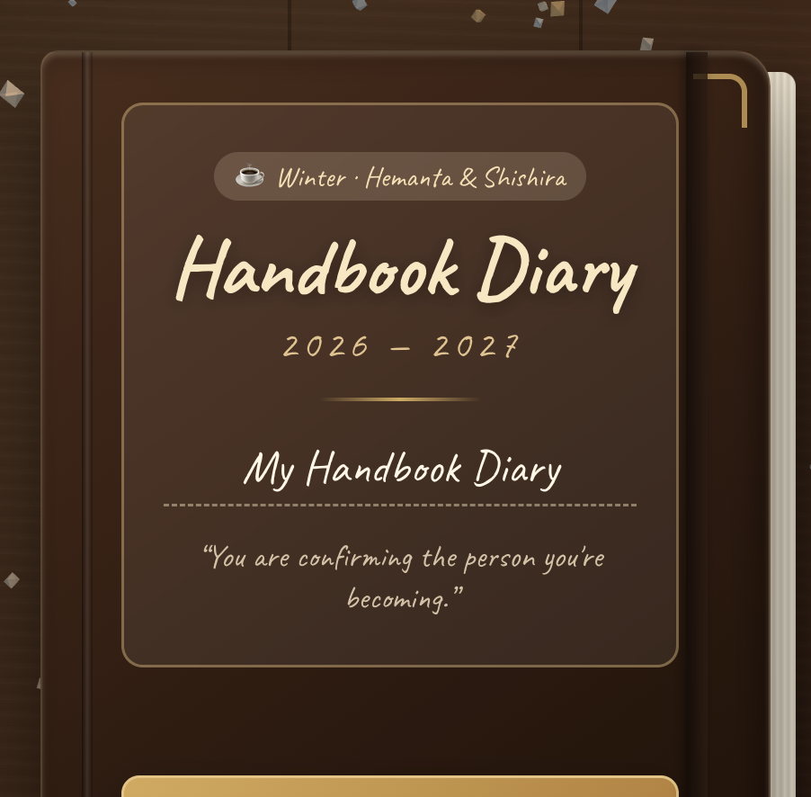
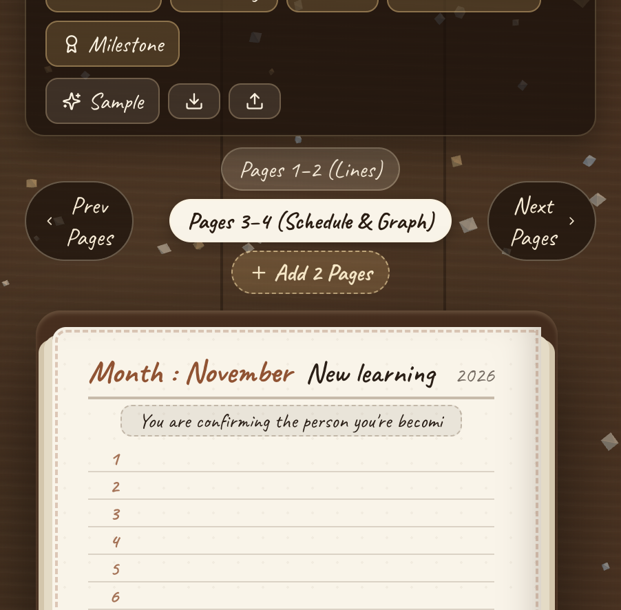
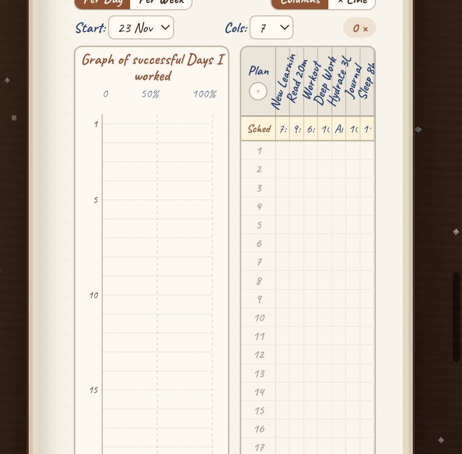
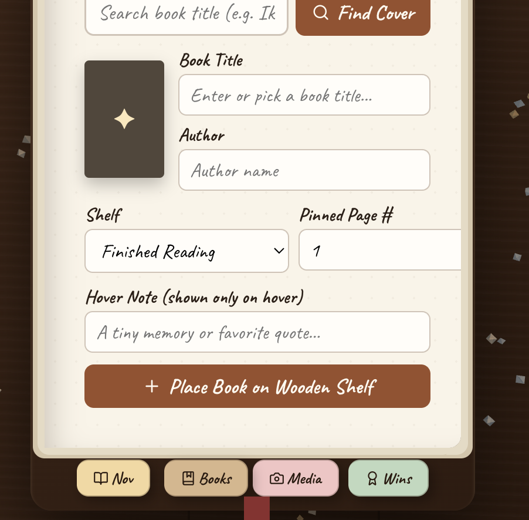

<div align="center">

# 📖✨ Handbook Diary 2026–27 ✨🪵

**A realistic wooden, Pinterest-inspired 3D Handbook Diary for tracking your daily progress, habits, books, cafe & movie memories, and milestones — built 100% in TypeScript + React + Three.js.**

[](https://mikotomisakaa2.github.io/HandbookDiary2026-27/)
[](https://www.typescriptlang.org/)
[](https://threejs.org/)
[](https://react.dev/)

🔗 **Live Link:** **[https://mikotomisakaa2.github.io/HandbookDiary2026-27/](https://mikotomisakaa2.github.io/HandbookDiary2026-27/)**

</div>

---

## 🖼️ Peek Inside the Handbook

<table>
  <tr>
    <td align="center" width="50%">
      
      <br />
      <b>📖 Wooden &amp; Leather 3D Opening Cover</b><br />
      <sub>Name your own journal &amp; lift the cover from your start day</sub>
    </td>
    <td align="center" width="50%">
      
      <br />
      <b>🗓️ Numbered Monthly Pages &amp; 3D Seasons</b><br />
      <sub>Exact days per month (28 / 29 / 30 / 31) with optional +2 pages</sub>
    </td>
  </tr>
  <tr>
    <td align="center" width="50%">
      
      <br />
      <b>📊 Schedule Table + Column &amp; × Line Graph</b><br />
      <sub>Custom columns, extra schedule row, start-day baseline &amp; × marks</sub>
    </td>
    <td align="center" width="50%">
      
      <br />
      <b>📚🪵 3-Tier Wooden Bookshelf</b><br />
      <sub>Auto-fetched book covers &amp; hover-only pinned page numbers</sub>
    </td>
  </tr>
</table>

---

## 🌦️ Indian Seasons in 3D (`Three.js`)

Every month of **2026–2027** transforms both the wooden desk texture and the **3D Three.js particle & lighting atmosphere** to match the real Indian season:

| Season | Indian Name | Months | Wooden Desk & 3D Atmosphere |
| :--- | :--- | :--- | :--- |
| ☕ **Winter** | *Hemanta & Shishira* | Nov, Dec, Jan | Dark walnut wood + drifting 3D frost flakes & warm candlelight motes |
| 🌸 **Spring** | *Vasanta* | Feb, Mar | Honey oak wood + tumbling 3D gulmohar & spring blossom petals |
| 🥭 **Summer** | *Grishma* | Apr, May, Jun | Sunlit mango wood + rising golden sunlit pollen motes |
| 🌧️ **Monsoon** | *Varsha* | Jul, Aug, Sep | Rain-kissed rosewood + falling 3D monsoon rain streaks |
| 🪔 **Autumn** | *Sharad* | Oct | Warm sheesham wood + glowing 3D festive diya embers & marigold petals |

---

## ✨ Key Features

### 📖 Realistic Book Opening & Custom Cover Name
- **Editable Journal Title & Owner Name:** Personalize your handbook right on the leather front cover (`Name your journal ✎` + `This handbook belongs to`).
- **3D Human Cover Lift:** Click **`Open from [Your Start Day] →`** to smoothly swing the leather cover open in 3D on its spine hinge, revealing your lined pages underneath.
- **Spiral Ring Binding & Side Index Tabs:** Realistic metallic spiral spine, stacked paper edges, ribbon bookmark, and quick-jump index tabs (`Nov`, `Books`, `Media`, `Wins`).

### 🗓️ Monthly Spreads & 📊 Schedule + Graph
- **Pages 1–2 (Monthly Lined):** Two lined pages numbered `1` to `28 / 29 / 30 / 31` matching each month's exact calendar length.
- **Pages 3–4 (Daily Learning + Schedule & Graph):**
  - **Page 3 (Left):** Month header, editable monthly motto (`New learning everyday`), subtitle badge (`You are confirming the person you're becoming`), and numbered daily lines.
  - **Page 4 (Right):**
    - **Schedule Table:** Pick your column count (`Cols: 2–10` or `+`), write times/plans in the **extra `Sched` row**, and click any date cell to draw a handwritten **`×`**.
    - **Dynamic Progress Graph (`Graph of successful Days I worked`):** Switch between **Column Graph** and **Hand-drawn `×` Line Graph**, toggle **Per Day** vs **Per Week**, and choose your **Start Date** so earlier days stay flat at `0`.
- **Optional Extra Pages (`+ Add 2 Pages`):** No compulsory blank 5–6 or 7–8 pages — add a fresh 2-page blank spread only when you want extra room.

### ✒️ Bottom Stationery Dock — Pen Ink, Handwritten Fonts & Highlighter
- **✒️ 6 Pen Ink Colors:** Espresso Ink, Fountain Blue, Burgundy, Forest Green, Terracotta, and Plum Ink.
- **✍️ 4 Handwritten Fonts Only:** `Caveat`, `Patrick Hand`, `Indie Flower`, and `Shadows Into Light`.
- **🖍️ Realistic Highlighter:** Toggle Highlighter mode, pick from 5 pastel marker colors (Sunshine Yellow, Blush Pink, Mint Green, Sky Blue, Warm Peach), and draw realistic multiply-blend marker strokes directly over any page — plus a 1-click Eraser 🧹.

### 📚🪵 3-Tier Wooden Bookshelf (Hover-Only Details)
- **🗄️ Three Wooden Shelves:**
  1. ✅ **Finished Reading**
  2. 🔖 **Partially Finished**
  3. 🛑 **Not Finished (Not Reading Further)**
- **🔍 Auto-Fetched Book Covers:** Search any book title to fetch its real cover via Open Library API (with Google Books fallback).
- **📌 Clean Shelf, Info on Hover:** Books sit cleanly on wooden ledges with bookmark pins — hovering over any book reveals its title, author, editable **pinned page number**, note, and shelf switcher.

### 📷 Photos, 🎞️ Videos, 🎵 Hover Songs & 📌 Pinterest Scrapbook
- **📷🎞️ Photos & Videos + Side Notes:** Upload cafe photos ☕, movie clicks 🎬, travel shots 🧭, or videos 🎞️ (stored locally in IndexedDB) taped with pastel washi tape — with a handwritten **Side Note** right beside every card.
- **🎵 Songs on Hover:** Attach a built-in ambient melody (*Lo-Fi Chai & Rain*, *Golden Sunset Piano*, *Monsoon Bansuri Breeze*, *Corner Cafe Acoustic*) or upload your own MP3/audio URL — hovering over the photo/video card gently plays the song!
- **✨ Cute Seasonal Stickers, 📝 Realistic Sticky Notes, 🔗 Link Bookmarks & 🏆 Milestones Earned:** Drag, tilt/rotate, edit, and place anywhere on any page.

---

## 🔒 Saving Your Work & Privacy

- **💾 Automatic Local Saving:** Everything you write, check, highlight, stick, or upload is saved automatically in **your own browser** (`localStorage` + `IndexedDB`). Close the tab and come back anytime on the same browser — your diary stays right where you left it.
- **🛡️ 100% Private Per Person:** Anyone else who opens the live link gets their **own fresh, private diary** stored only on *their* device. Nobody can see or overwrite your entries.
- **📦 Backup & Restore Anytime:** Use the **Download (JSON)** and **Upload (JSON)** buttons in the top-right wooden toolbar to export a personal backup or move your diary to another device.

---

## 🛠️ Tech Stack & Local Setup

- **TypeScript** (strict mode across all source files)
- **React 19 + Vite**
- **Three.js** (`three` + `@types/three`) for 3D Indian seasonal atmospheres
- **Web Audio API + IndexedDB + LocalStorage**
- **GitHub Actions + GitHub Pages** for free automatic deployment

```bash
# 1. Clone the repository
git clone https://github.com/mikotomisakaa2/HandbookDiary2026-27.git
cd HandbookDiary2026-27

# 2. Install dependencies
npm install

# 3. Start local dev server
npm run dev

# 4. Build for production
npm run build
```
